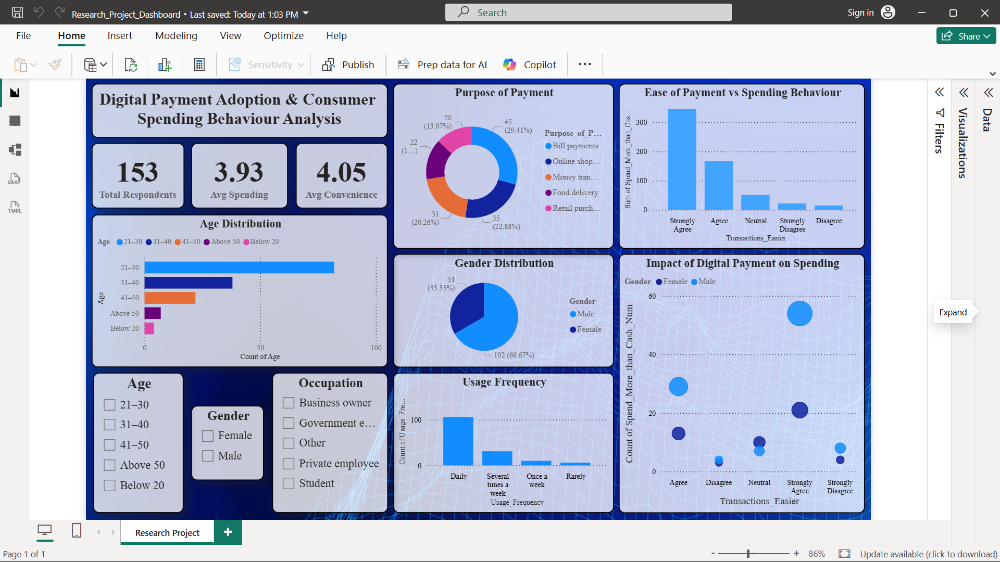

# Impact of Digital Payment Adoption on Consumer Spending Behaviour


MBA Research Project (Sinhgad Business School, Pune, SPPU, Batch 2024-2026)
using Python, Excel and Power BI.



## Problem Statement
Digital payments (UPI, wallets, cards, internet banking) are replacing cash
in India. This study examines whether digital payment adoption is associated
with how consumers spend, including purchase frequency, overall spending and
the influence of cashback offers.

## Objectives
- Understand who uses digital payments and how often
- Measure how convenience, purchase frequency and cashback relate to
  spending more than with cash
- Test three hypotheses statistically
- Present the findings in an interactive Power BI dashboard

## Dataset
Primary data from a structured questionnaire.
- **153 respondents** (convenience sampling, Warje, Pune)
- **24 variables**: demographics, usage patterns, Likert-scale spending
  perceptions, security and satisfaction
- Respondents are anonymous (no names included)

## Methodology
1. **Data cleaning (Python):** removed duplicates, stripped column names,
   handled missing values
2. **Exploratory analysis (Python):** age, gender, income, usage frequency,
   purpose of payment, reasons for use, cross-tab analysis
3. **Likert conversion:** responses mapped to scores 1 to 5, then mean and
   correlation analysis
4. **Hypothesis testing (Excel):** Chi-Square test of independence at the
   5% significance level
5. **Dashboard (Power BI):** KPIs, demographics, usage and spending visuals

## Hypotheses Tested
| # | Independent Variable | Dependent Variable |
|---|----------------------|--------------------|
| H1 | Transactions_Easier | Spend_More_than_Cash |
| H2 | Purchase_Frequency_Increase | Spend_More_than_Cash |
| H3 | Cashback_Encourages_Spending | Spend_More_than_Cash |

## Key Findings
- **Who uses it:** 21-30 is the largest age group (82 of 153); 66.7% of
  respondents are male and 33.3% female
- **How often:** over 100 respondents use digital payments daily
- **Why:** convenience, cashback/discounts and speed are the top reasons
- **Perception:** average convenience score is **4.05 / 5** and average
  "spend more than cash" score is **3.93 / 5**
- **Correlation:** ease of transactions and purchase frequency show the
  strongest positive link with spending more (about 0.74 and 0.67)

### Chi-Square Results (df = 16, critical value = 26.296)
| Hypothesis | Chi-Square Value | Result |
|------------|------------------|--------|
| H1: Transactions easier vs spending more | 152.04 | Null rejected |
| H2: Purchase frequency vs spending more | 112.83 | Null rejected |
| H3: Cashback vs spending more | 85.49 | Null rejected |

All three tests found a statistically significant association between digital
payment adoption factors and spending behaviour.

## Recommendations
- Businesses can pair digital payments with cashback and targeted offers
- Fintech platforms can add budgeting and spending-tracking features to
  support responsible spending
- Further research can use larger samples, other regions and comparisons
  with cash users

## Limitations
- Convenience sampling from one area (Warje, Pune), so results may not
  generalize
- Self-reported survey responses; the study shows association, not
  causation
- Only digital payment users were surveyed, with no cash-only comparison
  group
- Some chi-square cells have small expected counts (below 5), so results
  should be read with care

## Tools Used
Python (Pandas, NumPy, Matplotlib, Seaborn), Microsoft Excel (Chi-Square),
Power BI (DAX, dashboards)

## Project Structure
```
├── Research_Project.ipynb                     # Python analysis
├── New_Digital_Payment_..._Survey.xlsx        # Survey dataset
├── Research_Project_Sem_4.pbix                # Power BI dashboard
├── report/Research_Report.pdf                 # Full project report
├── images/dashboard.png                       # Dashboard screenshot
└── README.md
```

## How to Run
1. Download or clone this repository.
2. Install libraries: `pip install pandas numpy matplotlib seaborn openpyxl scikit-learn`
3. Open `Research_Project.ipynb` in Jupyter or VS Code and run all cells.
   Keep the Excel file in the same folder as the notebook.
4. The `.pbix` file cannot be previewed on GitHub. Download it and open it in Power BI Desktop, or see the dashboard screenshot above.
